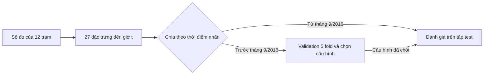
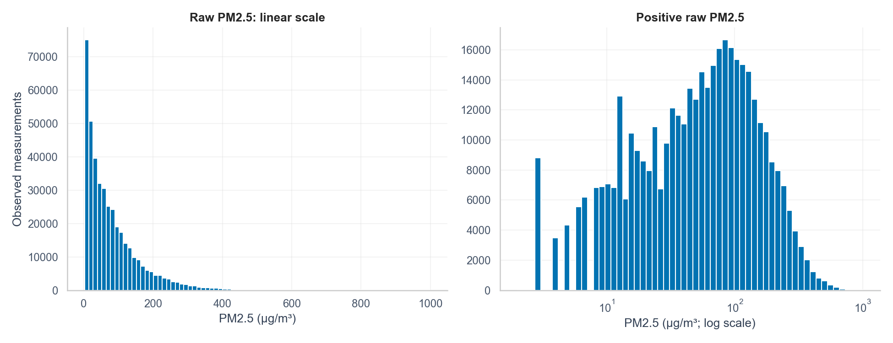
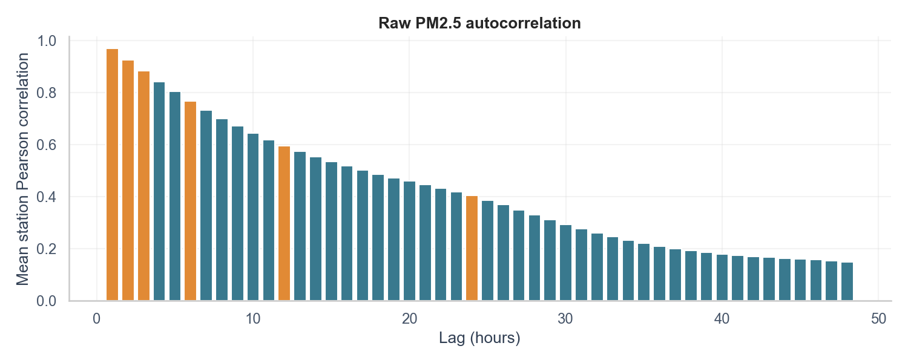
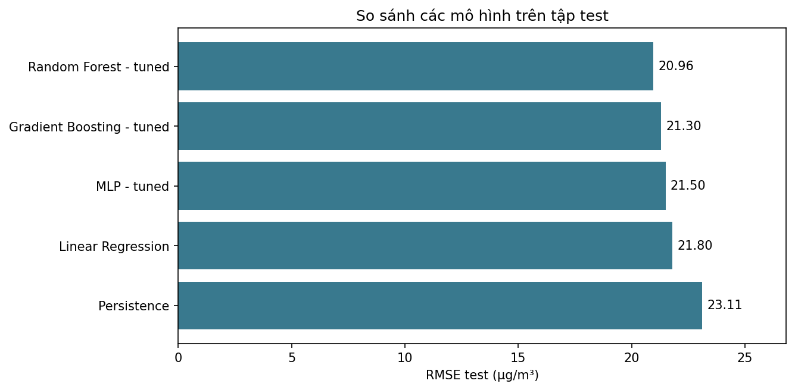

# Dự báo PM2.5 trước một giờ tại Bắc Kinh

**Đồ án cuối kỳ môn Máy học** · Nhóm 10 · Đại học Sài Gòn  
**Giảng viên hướng dẫn** · TS. Đỗ Như Tài  
**Bộ dữ liệu** · Beijing Multi-Site Air Quality

| Thành viên | MSSV |
| --- | --- |
| Trần Lê Gia Bảo (nhóm trưởng) | 3124411038 |
| Tô Thành Nhân | 3124411198 |
| Đào Hữu Tài | 3124411261 |
| Huỳnh Nhật Quang | 3124411245 |
| Nguyễn Thanh Tuấn | 3124411337 |

Đồ án dự báo nồng độ bụi mịn PM2.5 (µg/m³) ở giờ kế tiếp cho cùng một trạm, dựa trên số đo ô nhiễm, khí tượng và thông tin thời gian đến giờ hiện tại. Trên 51.063 mẫu test, **Random Forest sau tinh chỉnh có RMSE thấp nhất trong 5 mô hình được đánh giá**.

## Báo cáo đồ án

- [Đề cương](docs/Nhom10_BeijingAirQuality_Proposal.pdf) trình bày mục tiêu và thiết kế thực nghiệm.
- [Báo cáo cập nhật tiến độ](docs/Nhom10_BeijingAirQuality_BaoCaoGiuaKy.docx) và [slide trình bày](docs/Nhom10__Slide.pptx) tổng hợp phương pháp và kết quả.
- [Tài liệu dự án](docs/README.md) tập hợp phần phân công, các mục cần cập nhật và nguồn số liệu.

## Cách chạy

1. **Cài môi trường.** Mở PowerShell tại thư mục gốc của repo. Dùng Python 3.13 và scikit-learn 1.7.2 để nạp các mô hình đã lưu. [Danh sách thư viện](requirements.txt) · [Bản khóa đầy đủ trên Windows](requirements-lock.txt).

   ```powershell
   py -3.13 -m venv .venv
   .\.venv\Scripts\python.exe -m pip install -r requirements-lock.txt
   ```

2. **Chuẩn bị dữ liệu.** Đặt 12 CSV PRSA trong [thư mục dữ liệu gốc](data/raw/PRSA_Data_20130301-20170228/). Notebook 01 tạo [CSV chuẩn hóa](data/processed/beijing_air_quality_standardized.csv) để các notebook sau dùng chung.

3. **Mở notebook trong VS Code.** Chọn kernel Python trong `.venv`. Xem kết quả đã lưu trong [`notebooks/`](notebooks/), hoặc mở [`notebooks_unexecuted/`](notebooks_unexecuted/) và chạy lần lượt từ 01 đến 08 để tái lập từ đầu.

   | Notebook | Công việc |
   | --- | --- |
   | [01](notebooks/01_eda_and_preprocessing.ipynb) | Khảo sát dữ liệu và xuất CSV chuẩn hóa |
   | [02](notebooks/02_model_training_baseline.ipynb) | Đánh giá Persistence và Linear Regression trên validation |
   | [03](notebooks/03_random_forest.ipynb), [04](notebooks/04_gradient_boosting.ipynb) | Đánh giá hai mô hình cây ở cấu hình ban đầu |
   | [05](notebooks/05_tuning.ipynb) | Tinh chỉnh Random Forest và Gradient Boosting |
   | [06](notebooks/06_mlp_regression.ipynb), [07](notebooks/07_mlp_tuning.ipynb) | Đánh giá MLP ban đầu rồi tinh chỉnh |
   | [08](notebooks/08_final_evaluation.ipynb) | Đánh giá cuối trên tập test và phân tích sai số |

   Bật `SAVE_ARTIFACTS=True` ở các bước cần ghi bảng, biểu đồ và mô hình. Notebook 02 mặc định để `RUN_FINAL_TEST=False`. Nếu đã có CSV chuẩn hóa và đủ mô hình, có thể mở thẳng notebook 08. Bộ nạp ưu tiên [`models/`](models/) và tìm bản lưu trong thư mục thực nghiệm khi cần. [Hướng dẫn notebook chi tiết](notebooks/README.md).

4. **Kiểm thử và đối chiếu kết quả đã lưu.** Các lệnh dưới đây kiểm tra mã nguồn và đối chiếu CSV với bằng chứng trong notebook đã thực thi.

   ```powershell
   .\.venv\Scripts\python.exe -m pytest -q
   .\.venv\Scripts\python.exe -B scripts/verify_result_sources.py
   ```

   Tra notebook, mã ô và chế độ thực thi của từng bảng trong [`report_sources.csv`](outputs/notebooks/tables/report_sources.csv).

<details>
<summary>Chạy theo lô và cập nhật bảng báo cáo</summary>

```powershell
.\.venv\Scripts\python.exe -B scripts/run_notebooks.py 01 02 03 04 06 08
.\.venv\Scripts\python.exe -B scripts/run_notebooks.py 05 07 --verify-searches
.\.venv\Scripts\python.exe -B scripts/verify_result_sources.py
.\.venv\Scripts\python.exe -B scripts/refresh_experiment_tables.py
.\.venv\Scripts\python.exe -B scripts/build_report_requirements.py
```

Quy trình này cần các mô hình tinh chỉnh và kết quả tìm kiếm đã lưu. Cờ `--verify-searches` chỉ đối chiếu kết quả tìm kiếm của 05 và 07. Khi tái lập từ đầu theo thứ tự 01–08, chạy toàn bộ ô trong hai notebook tinh chỉnh trước khi đánh giá cuối. Sau khi sửa notebook gốc, dùng `scripts/sync_notebooks.py` để đồng bộ bản đã xóa đầu ra. Xem [các mục cần cập nhật trong báo cáo và slide](docs/nhung-phan-con-thieu-theo-yeu-cau-giang-vien.md).

</details>

## Phương pháp dự báo



- **Đầu vào.** Số đo ở giờ `t`, PM2.5 trễ 1, 2, 3, 6, 12 và 24 giờ, trung bình trượt 6 và 24 giờ, đặc trưng thời gian, trạm và hướng gió. **Đầu ra** là PM2.5 ở giờ `t+1` tại cùng trạm.
- **Tiền xử lý.** Điền tiếp giá trị quan trắc trong tối đa 6 giờ theo từng trạm. Giữ nguyên giá trị thiếu của nhãn rồi loại các mẫu thiếu nhãn. Bộ điền khuyết và chuẩn hóa của mỗi fold chỉ học từ phần huấn luyện.
- **Đánh giá.** Dùng 5 fold theo thời gian với cửa sổ huấn luyện mở rộng dần. Ba mô hình được tinh chỉnh bằng `RandomizedSearchCV`, chọn theo RMSE validation trung bình. Cấu hình được chốt trước khi chấm test. [Mã xử lý dữ liệu và tạo đặc trưng](src/README.md).

## Bộ dữ liệu Beijing Multi-Site Air Quality

Bộ PRSA gồm **420.768 bản ghi theo giờ** từ **12 trạm**, trong giai đoạn **01/03/2013–28/02/2017**. Sau khi tạo nhãn cho giờ kế tiếp và bỏ mẫu thiếu nhãn, còn **360.954 mẫu train/validation** và **51.063 mẫu test**. Tập test dùng nhãn từ **01/09/2016 đến 28/02/2017**. [Thống kê dữ liệu](outputs/eda/tables/dataset_counts.csv) · [Tổng hợp chia tập](outputs/eda/tables/target_split_summary.csv) · [Nguồn UCI](https://doi.org/10.24432/C5RK5G).

**Phân bố PM2.5 trên thang tuyến tính và thang log**



**Tự tương quan PM2.5 theo độ trễ**



Xem thêm [phân tích khám phá dữ liệu](outputs/eda/README.md) và [biểu đồ quan hệ giữa gió và PM2.5](outputs/eda/figures/pm25_wind_relationships.png).

## Mô hình và kết quả

### Danh sách mô hình

| Mô hình | Cách dự báo | Số tổ hợp tinh chỉnh |
| --- | --- | ---: |
| Persistence | Dùng PM2.5 ở giờ hiện tại làm dự báo | — |
| Linear Regression | Hồi quy tuyến tính với đặc trưng số được chuẩn hóa | — |
| Random Forest | Hồi quy bằng tổ hợp cây quyết định | 8 |
| Gradient Boosting | Hồi quy tăng cường theo histogram với `HistGradientBoostingRegressor` | 20 |
| MLP | Mạng nơ-ron truyền thẳng, chuẩn hóa đầu vào số và biến mục tiêu | 8 |

### Kết quả validation

RMSE tính bằng µg/m³, lấy trung bình số học trên 5 fold. Mức giảm được tính từ số liệu trước khi làm tròn.

| Mô hình | RMSE ban đầu | RMSE sau tinh chỉnh | Mức giảm |
| --- | ---: | ---: | ---: |
| Persistence | 19,9665 | — | — |
| Linear Regression | 19,2950 | — | — |
| Random Forest | 20,1707 | **19,1779** | 4,92% |
| Gradient Boosting | 21,9726 | 20,0384 | 8,80% |
| MLP | 20,0840 | 19,6317 | 2,25% |

Các điểm theo fold, MAE và R² nằm trong [thực nghiệm 01](outputs/experiments/experiments01/README.md), [thực nghiệm 02](outputs/experiments/experiments02/README.md) và [thực nghiệm 03](outputs/experiments/experiments03/README.md). Xem [chẩn đoán validation](outputs/experiments/validation_diagnostics/README.md) để tra độ quan trọng của các nhóm đặc trưng với Random Forest và độ ổn định của MLP theo seed.

### Kết quả trên tập test

| Hạng | Mô hình | MAE (µg/m³) | RMSE (µg/m³) | R² |
| ---: | --- | ---: | ---: | ---: |
| 1 | Random Forest tinh chỉnh | 10,5906 | **20,9613** | 0,9550 |
| 2 | Gradient Boosting tinh chỉnh | 10,8195 | 21,2957 | 0,9536 |
| 3 | MLP tinh chỉnh | 11,1583 | 21,4967 | 0,9527 |
| 4 | Linear Regression | 11,3510 | 21,8027 | 0,9513 |
| 5 | Persistence | 11,5864 | 23,1133 | 0,9453 |



Random Forest tinh chỉnh giảm RMSE **9,31%** so với Persistence. Khoảng tin cậy bootstrap ghép cặp 95% của chênh lệch RMSE giữa Random Forest và Gradient Boosting, cũng như giữa Random Forest và MLP, đều chứa 0. Trên nhóm có PM2.5 thực tế trên 250 µg/m³, hai mô hình Gradient Boosting và MLP có RMSE cao hơn Persistence. [Bảng test gốc](outputs/notebooks/tables/final_test_metrics.csv) · [Phân tích sai số và bootstrap](outputs/experiments/final_test/analysis/README.md).

### Tệp kết quả

| Đợt | Hồ sơ | Bảng đánh giá |
| --- | --- | --- |
| 01 | [Persistence và Linear Regression](outputs/experiments/experiments01/README.md) | [Excel](outputs/experiments/experiments01/danh_gia.xlsx) |
| 02 | [Random Forest, Gradient Boosting và MLP ban đầu](outputs/experiments/experiments02/README.md) | [Excel](outputs/experiments/experiments02/danh_gia.xlsx) |
| 03 | [So sánh trước và sau tinh chỉnh](outputs/experiments/experiments03/README.md) | [Excel](outputs/experiments/experiments03/danh_gia.xlsx) |
| Test | [Đánh giá cuối](outputs/experiments/final_test/README.md) | [Excel](outputs/experiments/final_test/danh_gia.xlsx) |

[Bảng CSV và Excel](outputs/notebooks/tables/) · [Biểu đồ notebook](outputs/notebooks/figures/README.md) · [Nhật ký CSV](experiment_log.csv) · [Hướng dẫn lưu từng lượt chạy](Experimental%20Log/README.md).

## Trích dẫn dữ liệu

Chen, S. (2017). *Beijing Multi-Site Air Quality*. UCI Machine Learning Repository. [DOI 10.24432/C5RK5G](https://doi.org/10.24432/C5RK5G) · [Giấy phép CC BY 4.0](https://creativecommons.org/licenses/by/4.0/).

```bibtex
@misc{chen2017beijing,
  author    = {Chen, Song},
  title     = {Beijing Multi-Site Air Quality},
  year      = {2017},
  publisher = {UCI Machine Learning Repository},
  doi       = {10.24432/C5RK5G},
  url       = {https://doi.org/10.24432/C5RK5G}
}
```
